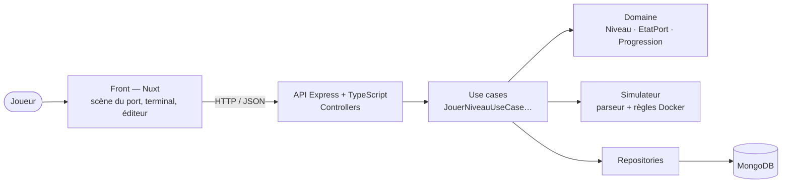
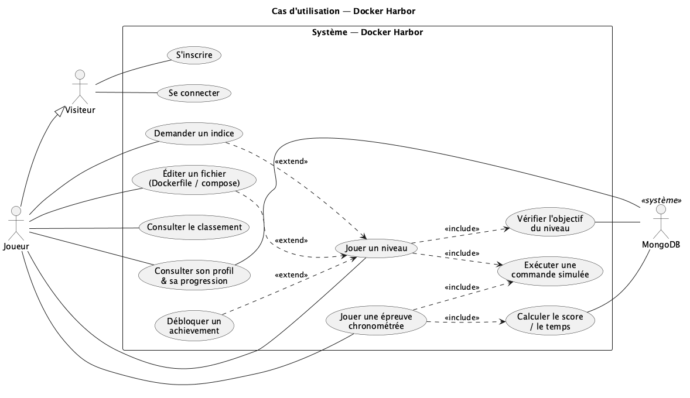
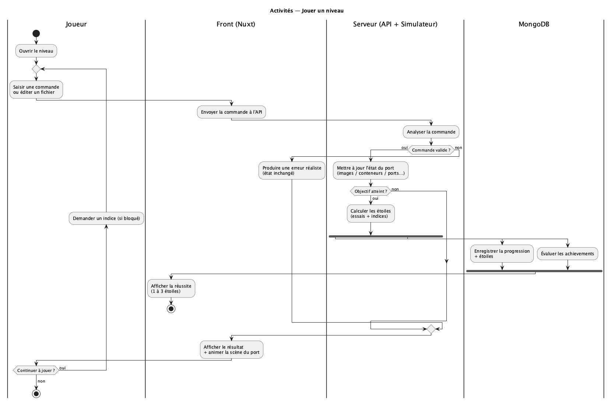
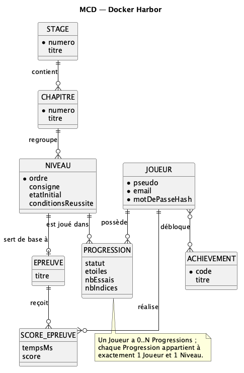
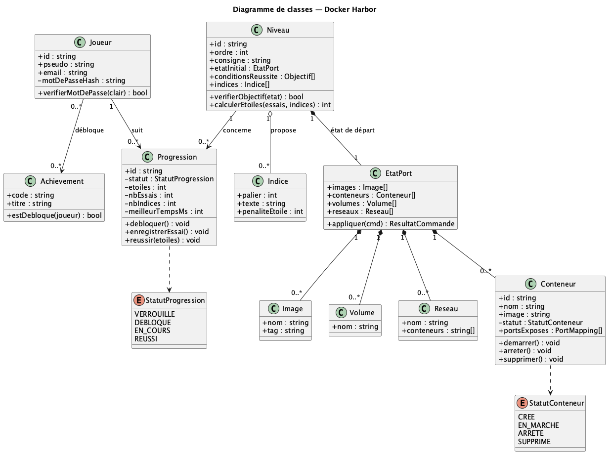
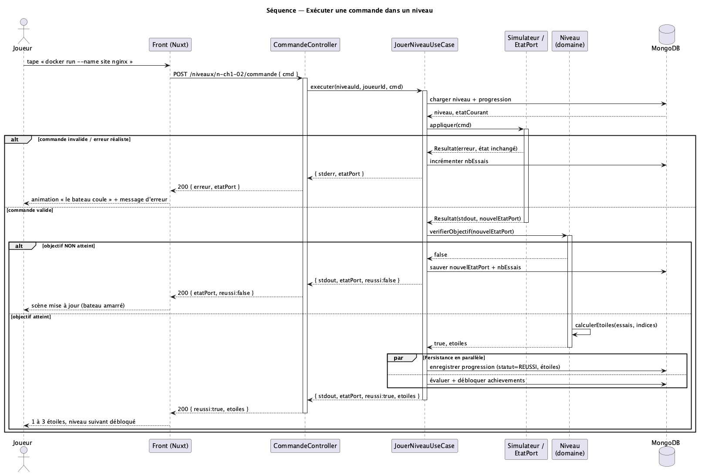
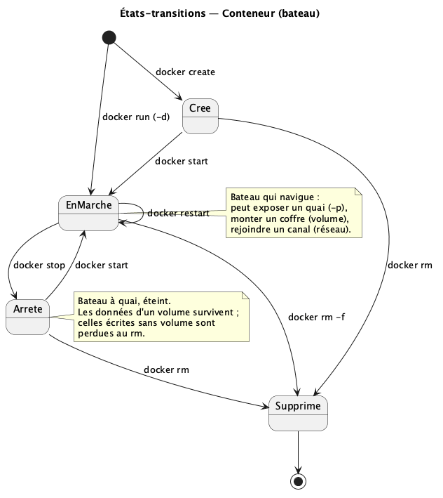
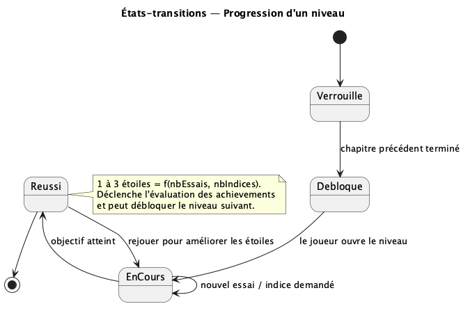

# Docker Harbor — Spécification technique

**Rendu du 08/11/2026** · Projet de groupe : André, Julien, Djibril · Dépôt : `AndreLiar/coordinationBackFront`

> **Docker Harbor** est un jeu web d'apprentissage de Docker. Docker y est **entièrement simulé côté serveur** et mis en scène sous la forme d'un **port de commerce** : les bateaux sont des conteneurs, les plans des images, les quais des ports exposés, les coffres des volumes, les canaux des réseaux.

---

## Sommaire

1. [Définition des besoins](#1-définition-des-besoins)
2. [Étude des utilisateur·rices](#2-étude-des-utilisateurrices)
3. [État de l'art](#3-état-de-lart)
4. [Solutions possibles et solution retenue](#4-solutions-possibles-et-solution-retenue)
5. [Détail de la solution retenue](#5-détail-de-la-solution-retenue)
   - [5.1 Fonctionnalités prévues](#51-fonctionnalités-prévues)
   - [5.2 Architecture logicielle](#52-architecture-logicielle)
   - [5.3 Langages et librairies](#53-langages-et-librairies)
   - [5.4 Modélisation du système](#54-modélisation-du-système)
   - [5.5 Maquettes des interfaces](#55-maquettes-des-interfaces)
   - [5.6 Organisation du travail](#56-organisation-du-travail)
   - [5.7 Organisation du repo git](#57-organisation-du-repo-git)

---

## 1. Définition des besoins

Docker est devenu un outil incontournable, mais il reste difficile à apprendre, et aucun jeu web visuel ne permet de le découvrir sans installation.

### Le problème

- **Docker est partout.** Il sert à lancer, livrer et déployer des applications dans la plupart des startups et des équipes de développement ; le connaître est un atout pour un stage ou un premier emploi.
- **Docker est abstrait.** Images, conteneurs, ports, volumes, réseaux sont invisibles : le débutant tape des commandes sans voir ce qu'elles font.
- **Les ressources existantes sont austères.** La documentation officielle et les tutoriels vidéo sont complets mais peu engageants.
- **La peur de casser sa machine.** Installer Docker ou supprimer des conteneurs et des volumes sur son propre ordinateur freine les débutants.
- **Il manque un jeu accessible.** Flexbox Froggy et Learn Git Branching ont prouvé que le jeu fonctionne pour apprendre un outil technique ; pour Docker, il n'existe aucun jeu web visuel et sans installation.

### Les objectifs pédagogiques

À la fin du jeu, le joueur doit savoir :

1. Comprendre la différence entre une image et un conteneur.
2. Lancer, lister, arrêter, redémarrer et supprimer des conteneurs.
3. Exposer un service vers l'hôte grâce aux ports.
4. Conserver des données grâce aux volumes et aux bind mounts.
5. Faire communiquer des conteneurs sur un réseau privé, sans rien exposer à l'hôte.
6. Écrire un Dockerfile et construire sa propre image.
7. Décrire une application complète avec docker-compose.
8. Intégrer Docker à son workflow de développement (environnement de dev, IDE, Windows containers).
9. Préparer une mise en production : staging, Swarm, sécurité de base.
10. Diagnostiquer et réparer une configuration cassée.

### Les besoins du joueur

- Apprendre sans installer Docker et sans risque pour sa machine.
- Voir l'effet de chaque commande immédiatement.
- Avancer progressivement, du débutant à l'avancé.
- Être guidé quand il bloque (aide sur les bases du terminal, indices).
- Retrouver sa progression d'une session à l'autre.
- Se mesurer aux autres une fois les bases acquises.

### Nos choix de départ et nos limites

| Sujet | Notre choix | Raison |
| --- | --- | --- |
| Front | **Nuxt** | Framework Vue complet (routage, composants) adapté à une application à plusieurs écrans avec une scène interactive |
| Back | **Express en TypeScript** | Le typage sécurise les entités du domaine et le simulateur |
| Base de données | **MongoDB** pour les comptes, la progression et les scores | Un niveau est un document (état initial, assertions, indices) : pas de jointures |
| Durée visée | **2 mois** | Garder un périmètre réaliste pour le groupe |
| Sécurité | **Aucun vrai Docker exécuté** : les commandes sont simulées par le serveur | Éviter les risques et le coût d'un vrai Docker par joueur |
| Niveau de l'équipe | Bases de Docker acquises, pas experts | *Limite réelle* : le projet nous fait aussi progresser |

### Comment nous comptons y répondre

Un **jeu web** où l'apprenant tape de vraies commandes Docker dans un terminal et voit leur effet dans une scène de port. Un « Simulateur » côté serveur tient un état fictif et répond comme Docker, erreurs comprises (`port is already allocated`, `No such container`…). Les objectifs, étoiles et scores sont calculés côté serveur ; les niveaux sont des documents en base, sans code par niveau.

### Périmètre

| Dans le périmètre | Hors périmètre |
| --- | --- |
| Inscription, connexion, campagne, épreuves chronométrées, indices, profil, classement, achievements | Exécution de vrais conteneurs |
| Simulation des commandes Docker par chapitre | Rôle administrateur (les niveaux sont des données chargées par les développeur·euses) |
| Validation et scoring côté serveur | Espace dédié aux expert·es Docker et aux enseignant·es |

---

## 2. Étude des utilisateur·rices

Notre public principal est le développeur ou l'étudiant en informatique, débutant ou intermédiaire sur Docker, qui joue par curiosité mais surtout pour apprendre.

### Public cible

| Critère | Description |
| --- | --- |
| Profil | Étudiant·es en informatique (BTS, BUT, licence, école d'ingénieur, bootcamp) et développeur·ses juniors |
| Âge | Majoritairement 18 à 30 ans |
| Niveau Docker | Aucun à intermédiaire : beaucoup connaissent Docker de nom ou ont copié un `docker run` sans le comprendre |
| Terminal | Connaissance basique (`cd`, `ls`) ; une aide sur les bases est proposée |
| Motivation | Surtout apprendre (cours, stage, entretien, projet perso), aussi la curiosité et le défi |
| Contexte de jeu | Sur ordinateur, chez soi ou entre deux cours, par sessions de 10 à 30 minutes |
| Hors cible | Experts Docker et enseignant·es (pas d'espace dédié) |

### Personas

**Léa, 20 ans, l'étudiante qui débute.** 2e année de BUT informatique ; son prof a mentionné Docker pour le projet de fin d'année. Elle connaît les bases du terminal et du web. Elle veut comprendre ce qu'est un conteneur et lancer son projet avec Docker. Frustrations : la documentation officielle la noie, elle a peur de casser son ordinateur. Elle attend des explications simples, une campagne guidée et des indices.

**Camara, 24 ans, le développeur junior en startup.** Développeur back-end depuis 6 mois ; son équipe utilise docker-compose tous les jours. Il lance `docker compose up` sans comprendre ce qui se passe derrière. Il veut maîtriser volumes, réseaux et Dockerfile pour ne plus dépendre de ses collègues. Frustrations : il n'ose pas poser de questions basiques et perd du temps quand deux conteneurs ne communiquent pas. Il attend de passer vite les bases et d'aller aux chapitres avancés et aux niveaux de dépannage.

**Yummy, 22 ans, le compétiteur curieux.** Étudiant en école d'ingénieur, à l'aise avec Linux, il connaît les commandes principales et un peu de docker-compose. Il veut se perfectionner et prouver son niveau ; les tutoriels sont trop lents pour lui. Il attend des épreuves chronométrées, un classement et des achievements.

### Ce que l'on en retient

| Besoin observé | Réponse dans le jeu |
| --- | --- |
| Comprendre des notions invisibles | Une scène visuelle du port qui réagit à chaque commande |
| Ne pas avoir peur de casser | Un Docker entièrement simulé, sans installation |
| Être guidé au début | Une campagne progressive, des indices et une aide sur le terminal |
| Avancer à son rythme | Des chapitres indépendants, la possibilité de passer aux niveaux avancés |
| Rester motivé | Étoiles, achievements, histoire et humour |
| Se mesurer aux autres | Des épreuves chronométrées avec classement |

### Parcours type

1. Le visiteur arrive sur l'accueil et crée un compte.
2. Il ouvre la carte de campagne et lance le chapitre 0 (tutoriel guidé).
3. Dans chaque niveau, il lit la consigne du client, tape des commandes, observe la scène et voit ses objectifs se cocher.
4. S'il est bloqué, il demande un indice (3 paliers, coût en étoiles de 0, −1 puis −2).
5. À la réussite, il obtient 1 à 3 étoiles ; un achievement peut se débloquer.
6. Il consulte son profil, tente les épreuves chronométrées et se compare au classement.

---

## 3. État de l'art

Des outils ludiques existent pour Docker, mais tous demandent d'installer Docker ou d'utiliser un terminal brut : aucun n'est un jeu web visuel, sans installation, pour débutant·es.

### Les jeux qui nous inspirent (autres sujets)

| Outil | Sujet | Ce que l'on retient |
| --- | --- | --- |
| Flexbox Froggy | CSS Flexbox | Niveaux très courts, retour visuel immédiat, aucune installation |
| Learn Git Branching | Git | Commandes simulées dans le navigateur, état visualisé sous forme d'arbre, niveaux par chapitres |

### Les outils existants pour apprendre Docker

| Outil | Type | Points forts | Limites pour notre public |
| --- | --- | --- | --- |
| Documentation officielle Docker | Tutoriel écrit | Complète, à jour, gratuite | Austère, aucune visualisation, pas de jeu |
| Play with Docker | Bac à sable dans le navigateur | Vrai Docker sans installation, gratuit | Déprécié, pas de parcours guidé, session limitée à quelques heures puis tout est effacé, compte Docker requis |
| Dockerlings | Exercices dans le terminal | Une quinzaine d'exercices progressifs, vérification instantanée, indices | Nécessite d'installer Go et Docker, interface texte uniquement |
| Learn Docker & K8s | Jeu narratif piloté par une IA | Histoire et personnages, 7 chapitres jusqu'à Kubernetes | Nécessite Docker et un éditeur avec IA, aucun visuel |
| KodeKloud | Plateforme de cours et labs | Labs dans le navigateur, quiz | Format cours en ligne, contenu complet en grande partie payant |

### Ce qui manque

- Aucun outil n'est à la fois ludique et visuel : les jeux Docker existants restent dans un terminal, on n'y voit jamais les conteneurs, les ports ou les réseaux.
- Tous demandent une installation, sauf Play with Docker, qui n'est pas un jeu.
- Peu de motivation sur la durée : pas de classement, peu d'achievements.

### Notre positionnement

Notre jeu reprend la recette de Flexbox Froggy et Learn Git Branching (simulation dans le navigateur, retour visuel, niveaux courts) et l'applique à Docker. Il se place **entre le tutoriel passif et le vrai bac à sable** : on tape de vraies commandes, mais l'état est **simulé et visualisé**, donc sans risque, sans coût d'infrastructure par joueur, et vérifiable. Contrepartie assumée : la fidélité au vrai Docker se limite aux commandes simulées (voir 5.1).

---

## 4. Solutions possibles et solution retenue

### Solution retenue

Nous retenons un jeu web où Docker est entièrement simulé par le serveur et représenté visuellement par un port de commerce : le joueur apprend avec de vraies commandes, sans rien installer.

### Le concept

Le joueur est le nouveau capitaine d'un port. Chaque élément de Docker a son équivalent visuel.

| Notion Docker | Représentation dans le jeu |
| --- | --- |
| Hôte (la machine) | Le port et sa capitainerie |
| Image | Un plan de bateau rangé dans l'entrepôt |
| Conteneur | Un bateau construit à partir d'un plan, avec son état (en marche, arrêté) |
| Port exposé (`-p`) | Un quai relié au bateau par une passerelle |
| Volume | Un coffre à quai qui reste quand le bateau part |
| Réseau Docker | Un canal privé entre bateaux, invisible depuis la ville |
| Dockerfile | Le chantier naval où l'on construit son propre plan |
| docker-compose | La flotte complète décrite sur un seul ordre de mission |
| Swarm, registre | L'amirauté et ses flottes réparties sur plusieurs ports |

### Le déroulé d'un niveau

1. Un client arrive avec une demande dans une bulle de dialogue (« Mon site doit être accessible sur le quai 8080 ! »).
2. Le joueur tape ses commandes dans un terminal simulé, ou écrit un fichier (Dockerfile, docker-compose.yml).
3. Le serveur analyse la commande, met à jour l'état du port et renvoie le résultat ou une erreur réaliste.
4. La scène s'anime : le bateau apparaît, la passerelle se pose, ou le bateau coule en cas d'erreur.
5. Quand l'objectif est atteint, le joueur reçoit de 1 à 3 étoiles selon le nombre d'essais et d'indices utilisés.

### Les choix techniques

- **Docker simulé, pas réel.** Le serveur Express contient un simulateur qui comprend un sous-ensemble de commandes Docker et tient un état fictif (images, conteneurs, ports, volumes, réseaux). Aucun risque de sécurité, aucun coût d'hébergement, comportement identique pour tous.
- **Niveaux décrits en données.** Chaque niveau est un document (état de départ, consigne, dialogues, conditions de réussite, indices) : ajouter un niveau ne demande pas de nouveau code.
- **Animations simples.** Scène 2D en grille, transitions CSS et composants de transition de Vue, sans moteur 3D, pour concentrer le temps sur le contenu.
- **Validation côté serveur.** Scores et temps des épreuves sont calculés par le serveur pour éviter la triche au classement.
- **Architecture.** Le navigateur (Nuxt) envoie chaque commande à l'API Express ; le serveur la simule, vérifie l'objectif du niveau et enregistre la progression dans MongoDB. Le front se contente d'afficher l'état du port qu'il reçoit.

### Les alternatives écartées

| Alternative | Pourquoi nous l'avons écartée |
| --- | --- |
| Exécuter un vrai Docker pour chaque joueur | Risques de sécurité, hébergement coûteux et complexe |
| Une scène en 3D (Three.js) | Animations longues à produire, peu de valeur pédagogique en plus |
| Un simple tutoriel ou un quiz | Pas assez ludique, n'apporte rien face à la documentation existante |
| Docker dans un terminal | Trop complexe et pas assez ludique |
| Simulateur exécuté dans le navigateur | Triche possible sur scores et classement, logique de validation exposée au client |

### Décisions de conception comparées

| Question | Option écartée | Option retenue | Justification |
| --- | --- | --- | --- |
| Comment stocker les achievements débloqués ? | Collection de jonction joueur ↔ achievement | **Tableau embarqué** `achievements[]` dans `joueurs` (catalogue dans `achievements`) | Peu nombreux, lus avec le profil, écrits rarement : pas de jointure |
| Comment modéliser une épreuve chronométrée ? | Entité `Epreuve` séparée | **Un `Niveau` de `type = EPREUVE`** | Une entité en moins ; les scores référencent directement `niveauId` |
| Faut-il un acteur Admin ? | Interface d'administration | **Non** : niveaux et épreuves = données chargées par les développeur·euses | Hors périmètre runtime, gain de temps sur 2 mois |
| Comment valider la réussite d'un niveau ? | Comparer à la commande attendue | **Assertions sur l'état final** (`conditionsReussite`, ET logique) | Plusieurs solutions valides acceptées (`run -d` ≡ `create` + `start`) |
| Quelle notation pour les diagrammes ? | Mermaid seul (approximations en flowchart) | **Mermaid et PlantUML** (sources et PNG versionnés) | Mermaid est rendu par GitHub ; PlantUML donne la notation UML stricte |

---

## 5. Détail de la solution retenue

### 5.1 Fonctionnalités prévues

Le jeu repose sur une campagne d'environ 35 niveaux en 3 stages, complétée par des épreuves chronométrées avec classement. Le rendu vise au minimum les chapitres 0 à 2, avec au moins 4 à 5 niveaux jouables de bout en bout.

#### 5.1.1 Le mode campagne

Les chapitres se débloquent dans l'ordre ; chaque niveau dure de 2 à 5 minutes.

| Stage | Chapitre | Niveaux | Notions |
| --- | --- | :-: | --- |
| 1. Les bases | 0. Bienvenue au port | 1 | Terminal, `help`, `hello-world` |
| 1. Les bases | 1. Premiers bateaux | 4 | Image et conteneur, `pull`, `run`, `ps`, `stop`, `start`, `rm`, `--name`, `-d` |
| 1. Les bases | 2. Ouvrir les quais | 3 | `-p`, plusieurs conteneurs, conflit de ports |
| 1. Les bases | 3. Inspecter et dépanner | 3 | `logs`, `exec`, `inspect`, `-e` |
| 1. Les bases | 4. Les coffres | 3 | Volumes, bind mounts, perte de données |
| 1. Les bases | 5. Les canaux privés | 3 | Réseaux, résolution par nom |
| 1. Les bases | 6. Le chantier naval | 4 | Dockerfile, `build`, tags, cache des couches |
| 1. Les bases | 7. La flotte | 4 | docker-compose : services, `depends_on`, `up`, `down` |
| 2. Creuser | 8. L'atelier | 4 | Workflow de dev, `.env`, `devcontainer.json`, Windows containers, débogage |
| 3. Vers le staging | 9. L'amirauté | 6 | Registre, staging, Swarm, sécurité, images allégées |

Dans chaque niveau :

- un terminal simulé qui répond comme le vrai Docker, erreurs comprises ;
- un éditeur de fichiers pour le Dockerfile et le docker-compose.yml (chapitres 6 et suivants) ;
- une scène du port qui se met à jour à chaque commande ;
- des indices en 3 niveaux (une piste, la commande, la solution), chacun réduisant le nombre d'étoiles ;
- une aide au terminal pour les débutant·es, et la commande `help` partout ;
- des erreurs drôles et pédagogiques : le client frappe à une porte fermée si le port n'est pas exposé, le coffre coule si le volume est oublié ;
- une note de 1 à 3 étoiles selon les essais et les indices.

#### 5.1.2 Les épreuves chronométrées

Des niveaux « problème » mettent le joueur face à une situation cassée à réparer le plus vite possible (un port déjà occupé, un conteneur qui n'atteint pas la base, un docker-compose.yml avec trois erreurs). Elles se débloquent au fil de la campagne. Chronomètre et score sont calculés par le serveur, chaque indice ajoute une pénalité de temps, et un classement par épreuve affiche les meilleurs temps.

#### 5.1.3 Les comptes joueurs

- Inscription et connexion avec pseudo, e-mail et mot de passe chiffré, session par jeton.
- Sauvegarde automatique de la progression, des étoiles et des temps dans MongoDB.
- Page de profil : chapitres terminés, étoiles, meilleurs temps, achievements.

#### 5.1.4 Les achievements

| Achievement | Condition |
| --- | --- |
| Premier amarrage | Lancer son premier conteneur |
| Capitaine sans fautes | Finir un chapitre avec 3 étoiles partout |
| Sans filet | Finir 5 niveaux sans aucun indice |
| Ingénieur naval | Construire sa première image avec un Dockerfile |
| Amiral de la flotte | Terminer le chapitre docker-compose |
| Éclair | Finir une épreuve en moins de 60 secondes |
| Naufrageur | Perdre ses données en oubliant un volume |

#### 5.1.5 Priorisation pour le rendu

| Fonctionnalité | Priorité |
| --- | --- |
| Inscription et connexion | Indispensable |
| Terminal simulé et simulateur des commandes de base | Indispensable |
| Scène du port animée | Indispensable |
| Campagne : chapitres 0 à 2 (4 à 5 niveaux minimum) | Indispensable |
| Sauvegarde de la progression et étoiles | Indispensable |
| Indices et aide au terminal | Indispensable |
| Campagne : chapitres 3 à 5 (logs, volumes, réseaux) | Important |
| Épreuves chronométrées et classement | Important |
| Achievements et page de profil | Important |
| Campagne : chapitres 6 et 7 (Dockerfile, compose) et éditeur de fichiers | Bonus |
| Stage 2 (workflow, IDE, Windows containers) | Bonus, feuille de route |
| Stage 3 (staging, Swarm, sécurité) | Bonus, feuille de route |
| Carnet de bord récapitulant les commandes apprises | Bonus |

Les fonctionnalités indispensables suffisent à livrer un jeu complet et jouable ; les autres s'ajoutent sans changer l'architecture, puisque les niveaux sont décrits en données.

#### 5.1.6 Contenu du simulateur

Le jeu de commandes est **cumulatif** : chaque chapitre ajoute des commandes à celles déjà apprises. Tout ce qui n'est pas supporté produit une erreur « commande inconnue » ou « option non supportée » (le parseur distingue les deux pour des messages d'aide ciblés).

| Chapitre | Commandes et options simulées |
| --- | --- |
| Transverses | `help`, `<cmd> --help`, `clear`, `docker ps` / `ps -a`, `docker images` (alias `container ls`, `image ls`) |
| 0 | `docker run hello-world` (pull implicite, conteneur qui se termine) |
| 1 | `pull <image>[:tag]`, `run [--name] [-d]`, `ps [-a]`, `stop`, `start`, `rm [-f]` |
| 2 | `run -p hôte:conteneur` (répétable), plusieurs conteneurs |
| 3 | `logs [-f] [--tail N]`, `exec [-it]`, `inspect`, `run -e CLE=VALEUR` |
| 4 | `volume create/ls/rm`, `run -v volume:/chemin`, bind mount `-v /hôte:/chemin` |
| 5 | `network create/ls/connect`, `run --network` |
| 6 | `build -t nom:tag [-f]`, `tag` ; instructions `FROM WORKDIR COPY RUN ENV EXPOSE CMD` |
| 7 | `compose up [-d --build]`, `down [-v]`, `ps`, `logs` (syntaxes `docker compose` et `docker-compose`) |
| 8 | `--env-file`, `devcontainer.json`, image Windows simulée |
| 9 | `login`, `push`, `pull <registre>/`, `swarm init`, `service create --replicas`, `stack deploy -c` |

**Catalogue d'erreurs réalistes** (chaque entrée donne au moins un test) : `IMAGE_NOT_FOUND`, `NAME_CONFLICT`, `PORT_ALLOCATED`, `NO_SUCH_CONTAINER`, `RUNNING_RM`, `NOT_RUNNING_EXEC`, `NETWORK_NOT_FOUND`, `NAME_RESOLUTION`, `NOT_SWARM_MANAGER`, `COMPOSE_INVALID`.

### 5.2 Architecture logicielle

#### 5.2.1 Vue d'ensemble



#### 5.2.2 Couches et responsabilités

| Couche | Responsabilité |
| --- | --- |
| **Front (Nuxt)** | Affichage uniquement : scène 2D en grille, terminal, objectifs, panneaux. Aucune règle de jeu. |
| **`CommandeController`** | Entrée HTTP, (dé)sérialisation, codes de statut |
| **`JouerNiveauUseCase`** | Orchestration : charger, simuler, valider, persister |
| **`Simulateur / EtatPort`** | Applique la commande, maintient l'état fictif du port |
| **`Niveau`** (domaine) | Règles métier : objectif atteint ? combien d'étoiles ? |
| **Repositories / MongoDB** | Persistance des progressions, scores, achievements |

#### 5.2.3 Principes structurants

1. **Validation 100 % serveur** : le client ne reçoit que des résultats (stdout / stderr, état du port, `reussi`, étoiles).
2. **Niveaux = données** : un niveau est un document ; ses `conditionsReussite` sont validées par **JSON Schema** au chargement. Un type d'assertion inconnu est détecté au chargement, pas pendant la partie.
3. **Assertions sur l'état final** : 17 types (`conteneurExiste`, `portExpose`, `volumeMonte`, `resolutionNom`, `serviceActif`…), combinés en ET logique. Un nouveau type = une entrée dans le schéma, un cas dans l'évaluateur, des tests.
4. **Machine à états du conteneur** : la table de transitions est la **source de vérité** du simulateur et de ses tests.
5. **Invariants protégés par le domaine** : un statut n'est pas modifiable librement, on passe par `debloquer()`, `enregistrerEssai()`, `reussir()`.

#### 5.2.4 Interface HTTP

| Route | Rôle | Statut |
| --- | --- | --- |
| `POST /niveaux/:id/commande` · corps `{ cmd }` | Exécute une commande et renvoie `{ stdout / stderr, etatPort, reussi, etoiles? }` | documentée |
| Inscription, connexion (jeton) | Gestion des comptes et des sessions | à définir |
| Carte de campagne, niveau, indices | Lecture du contenu et de la progression | à définir |
| Profil, classement, scores d'épreuve | Consultation et enregistrement | à définir |

#### 5.2.5 Modèle de données (MongoDB)

| Collection | Contenu |
| --- | --- |
| `joueurs` | pseudo, email, `motDePasseHash`, dates, `achievements[]` embarqués `{ code, dateObtention }` |
| `niveaux` | `chapitreId`, ordre, `type` (`CAMPAGNE` / `EPREUVE`), consigne, `etatInitial`, `conditionsReussite`, `indices[]`, `dialogues[]`, `epreuve?` |
| `chapitres` | `stageId`, numéro, titre |
| `progressions` | `joueurId`, `niveauId`, statut, étoiles, `nbEssais`, `nbIndices`, `meilleurTempsMs` |
| `scores` | `joueurId`, `niveauId`, `tempsMs`, `score`, date |
| `achievements` | code, titre, condition *(catalogue)* |

Exemple de document `niveaux` (« Premier bateau », chapitre 1) :

```json
{
  "_id": "n-ch1-02",
  "chapitreId": "ch-1",
  "ordre": 2,
  "type": "CAMPAGNE",
  "titre": "Premier bateau",
  "consigne": "Lance un conteneur nginx nommé 'site'.",
  "etatInitial": { "images": [{ "nom": "nginx", "tag": "latest" }],
                   "conteneurs": [], "volumes": [], "reseaux": [] },
  "conditionsReussite": [
    { "type": "conteneurExiste", "nom": "site", "statut": "RUNNING", "image": "nginx" }
  ],
  "indices": [
    { "palier": 1, "texte": "Il faut 'lancer' une image.", "penaliteEtoile": 0 },
    { "palier": 2, "texte": "Regarde la commande 'docker run'.", "penaliteEtoile": 1 },
    { "palier": 3, "texte": "docker run --name site nginx", "penaliteEtoile": 2 }
  ]
}
```

### 5.3 Langages et librairies

| Domaine | Choix | Justification |
| --- | --- | --- |
| Front | **Nuxt** (Vue, TypeScript) | Choix de l'équipe. Routage par fichiers et composants adaptés à une application à plusieurs écrans avec scène interactive |
| Back | **Express + TypeScript** | Choix de l'équipe. Le typage sécurise les entités du domaine (`EtatPort`, `Niveau`, assertions) et le simulateur |
| Base de données | **MongoDB** | Choix de l'équipe. Un niveau est un **document** (état initial, assertions et indices embarqués) : pas de jointures |
| Animations | **CSS** et composants de transition de Vue, scène 2D en grille | Pas de moteur 3D (Three.js écarté) pour concentrer le temps sur le contenu |
| Authentification | Mot de passe chiffré (hash) et **session par jeton** | Bibliothèque de hachage et de jetons à choisir (par ex. bcrypt ou argon2, JWT) |
| Validation des niveaux | **JSON Schema** (par ex. Ajv) | Détecter les données de niveau invalides au chargement |
| Tests | Framework de test TypeScript (Vitest ou Jest) | Chaque erreur du catalogue et chaque transition du conteneur sont testées |
| Modélisation | **Mermaid** et **PlantUML** | Diagrammes versionnés avec le code |
| Maquettes | **Figma** | Voir 5.5 |

**Pourquoi pas une base SQL ?** Les niveaux sont des objets hétérogènes (assertions de types variés, état initial imbriqué) ; un schéma relationnel imposerait de nombreuses tables ou des colonnes JSON. Les relations simples (joueur ↔ progression) se gèrent par références d'`_id`.

### 5.4 Modélisation du système

Démarche suivie : **Cas d'utilisation → Activités → Données (MCD + classes) → Séquence → États-transitions**. Sources éditables en Mermaid et PlantUML dans `docs/modelisation/`, PNG dans `docs/modelisation/img/`.

#### 5.4.1 Cas d'utilisation



- **`<<include>>`** (obligatoire) : « Jouer un niveau » inclut toujours « Exécuter une commande simulée » et « Vérifier l'objectif » ; « Jouer une épreuve » inclut « Calculer le score / le temps ».
- **`<<extend>>`** (conditionnel) : « Demander un indice », « Éditer un fichier » et « Débloquer un achievement ».
- **Généralisation** : tout `Joueur` est aussi un `Visiteur`.

#### 5.4.2 Diagramme d'activités — « Jouer un niveau »



Quatre couloirs (Joueur, Front, Serveur, MongoDB), trois décisions (commande valide ? objectif atteint ? bloqué ?) et un **fork / join** : à la réussite, l'enregistrement de la progression et l'évaluation des achievements se font en parallèle.

#### 5.4.3 Modèle conceptuel de données (MCD)



Un joueur a 0..N progressions ; un stage contient des chapitres qui regroupent des niveaux ; une épreuve est un niveau de type `EPREUVE`.

#### 5.4.4 Diagramme de classes



On y ajoute les comportements : `Niveau.verifierObjectif()`, `Niveau.calculerEtoiles()`, `Progression.reussir()`, `EtatPort.appliquer(cmd)`. **Composition** : `EtatPort` possède ses conteneurs, images, volumes et réseaux. **Agrégation** : `Niveau` référence des `Indice` réutilisables.

#### 5.4.5 Diagramme de séquence — « Exécuter une commande »



Chaîne Controller → Use Case → Simulateur → Niveau → MongoDB, avec fragments `alt` (commande invalide / valide, objectif atteint ou non) et `par` (persistance en parallèle).

#### 5.4.6 Diagrammes d'états-transitions

Cycle de vie d'un **conteneur** (bateau) :



| État source | Événement | Garde | État cible |
| --- | --- | --- | --- |
| *(aucun)* | `docker create` | image présente | Créé |
| *(aucun)* | `docker run -d` | image présente, nom libre, port libre | En marche |
| Créé | `docker start` | — | En marche |
| En marche | `docker stop` | — | Arrêté |
| Arrêté | `docker start` | port encore libre | En marche |
| Arrêté / Créé | `docker rm` | — | Supprimé |
| En marche | `docker rm` | **refusé** sans `-f` | En marche |

Cycle de vie d'une **progression** (Verrouillé → Débloqué → En cours → Réussi, avec retour possible vers En cours pour rejouer) :



### 5.5 Maquettes des interfaces

**Fichier Figma :** https://www.figma.com/design/Q1OyhskvN7SOBA726LDSZP

| Paramètre | Choix |
| --- | --- |
| Format | Desktop 1440 × 900 |
| Thème | Marine uniquement |
| Langue | Français (commandes et sorties Docker en anglais, comme le vrai Docker) |
| Style de la scène | Illustration 2D flat, vue de côté |
| Éditeur (ch. 6 à 8) | Écran divisé scène / éditeur |
| Typographie | Nunito (titres, texte) et JetBrains Mono (terminal, code) |

#### 5.5.1 Organisation du fichier

3 pages : **Fondations & composants** (couleurs, typographie, composants) · **Écrans transverses** (accès, carte de campagne, profil et classement, épreuve / victoire / aide) · **Chapitres 0 à 9** (une section par chapitre).

#### 5.5.2 Gabarit commun d'un écran de niveau

| Zone | Contenu |
| --- | --- |
| En-tête (64 px) | Retour carte, titre du chapitre et du niveau, étoiles, bouton Indice (0/3) |
| Scène du port (gauche) | Illustration de l'état du simulateur |
| Capitaine (droite, haut) | Portrait et bulle de dialogue (fond corail clair en cas d'erreur) |
| Objectifs (droite, milieu) | Cases à cocher des conditions de réussite |
| Panneau contextuel (droite, bas) | Onglets propres au chapitre (registre, quais, journal, coffres…) |
| Terminal (bas) | Commande saisie et sortie |

#### 5.5.3 Écrans transverses

Accueil · Inscription · Connexion · Carte de campagne (10 îlots, 3 zones) · Profil · Classement · Épreuve chronométrée · Victoire · Besoin d'aide.

#### 5.5.4 Composants réutilisables

Bateau (4 états), Quai (libre / occupé / conflit), Coffre (vide / branché / coulé), Canal, Plan (image), Étoiles (0 à 3), Capitaine (4 expressions), Bulle capitaine, Bouton, Terminal.

#### 5.5.5 Feedback d'erreur commun

1. **Terminal** : `stderr` en corail, message identique au vrai Docker.
2. **Scène** : réaction visuelle (bateau fantôme, passerelle barrée, coffre coulé).
3. **Capitaine** : expression *Inquiet* et bulle ciblée.
4. **Objectifs** : cases cochées au fil de l'état atteint, sans afficher la commande à taper.

**À aligner** : l'écran d'épreuve de la maquette n'a ni étoiles ni bouton Indice, alors que le rendu de séance 1 prévoit une pénalité de temps par indice dans les épreuves. Il faut trancher entre les deux et mettre à jour la maquette ou le texte.

Le détail écran par écran des 10 chapitres figure dans `docs/maquette/composition-maquette-figma.md`.

### 5.6 Organisation du travail

> Non documentée dans les sources : proposition à ajuster à ce que le groupe fait réellement.

**Équipe** : André, Julien, Djibril.

**Méthode.** Approche **agile légère** adaptée à ~2 mois :

- itérations courtes (1 à 2 semaines) avec un objectif livrable à chaque fois ;
- **priorisation par les paliers Indispensable / Important / Bonus** de la section 5.1 : on n'entame un palier que lorsque le précédent est jouable de bout en bout ;
- un tableau de suivi (Kanban : À faire / En cours / En revue / Terminé) ;
- un point d'équipe régulier pour synchroniser front, back et contenu.

**Répartition possible en pôles :**

| Pôle | Périmètre |
| --- | --- |
| **Simulateur / API** | Parseur de commandes, `EtatPort`, assertions, use cases, tests, comptes et jetons |
| **Front / scène** | Écrans Nuxt, scène 2D, terminal, éditeur, intégration des maquettes |
| **Contenu et données** | Niveaux (documents JSON), dialogues, indices, achievements, schéma de validation |

**Contrats entre pôles.** Les documents *commandes par chapitre*, *conditions de réussite* et la **table de transitions** du conteneur sont les références communes : le contenu décrit les niveaux avec ces assertions, le simulateur les évalue, le front affiche l'état renvoyé.

**Qualité.** Chaque erreur du catalogue et chaque transition du conteneur ont leur test ; relecture par au moins une autre personne avant fusion.

### 5.7 Organisation du repo git

#### 5.7.1 État actuel

Dépôt `coordinationBackFront`, branche `main`, qui contient pour l'instant la **documentation de conception** :

```text
.
├── .gitignore
└── docs/
    ├── maquette/
    │   └── composition-maquette-figma.md
    ├── modelisation/
    │   ├── README.md, RENDU.md
    │   ├── 00-acteurs-perimetre.md … 05-etats-transitions.md   (Mermaid)
    │   ├── *.puml                                              (PlantUML)
    │   └── img/                                                (PNG rendus)
    └── simulateur/
        ├── commandes-par-chapitre.md
        └── conditions-reussite.md
```

Le `.gitignore` exclut `node_modules/`, `dist/`, `.output/`, `.nuxt/` (builds Nuxt et TypeScript), les fichiers `.env` (hors `.env.example`), les logs et fichiers système.

#### 5.7.2 Organisation cible

Le nom du dépôt (*BackFront*) et le `.gitignore` indiquent un **dépôt unique** pour le front et le back :

```text
.
├── front/        # application Nuxt
├── back/         # API Express + TypeScript (simulateur, domaine, use cases)
├── docs/         # conception (existant)
└── README.md     # installation et lancement
```

| Sujet | Convention proposée |
| --- | --- |
| **Branches** | `main` toujours stable ; une branche par fonctionnalité (`feat/…`, `fix/…`, `docs/…`) |
| **Intégration** | Pull request relue par au moins un autre membre avant fusion dans `main` |
| **Messages de commit** | Format *Conventional Commits* (`feat:`, `fix:`, `docs:`, `test:`) |
| **Secrets** | Jamais committés : `.env` ignoré, `.env.example` fourni |
| **Diagrammes** | Sources (`.puml` / Mermaid) et PNG versionnés ; régénération : `plantuml -tpng -o img docs/modelisation/*.puml` |

**Pourquoi un dépôt unique ?** Front et back partagent le même vocabulaire (niveaux, assertions, état du port) et évoluent ensemble ; un seul dépôt simplifie les pull requests transverses et garde la documentation à côté du code, au prix d'un historique plus mélangé.