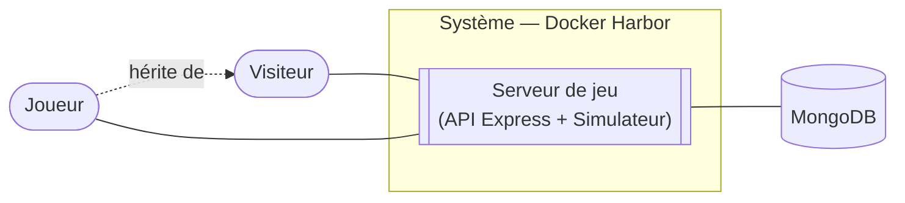

# 0. Acteurs et périmètre

[← Index](./README.md)

| Élément | Rôle |
| --- | --- |
| **Visiteur** *(acteur)* | Personne non connectée : peut s'inscrire et se connecter. |
| **Joueur** *(acteur)* | Visiteur authentifié : joue la campagne, les épreuves, consulte son profil. *(hérite de Visiteur)* |
| **Serveur de jeu** (API Express + Simulateur) | Cœur **interne** du système : simule Docker, valide les objectifs, calcule scores/étoiles. Pas un acteur. |
| **MongoDB** | **Système de support** (persistance : comptes, progression, scores). **Pas un acteur** : aucune logique métier ni calcul — simple dépendance technique montrée ici pour le périmètre. |

Le système ne lance **aucun vrai Docker** : le « Simulateur » tient un état fictif
(images, conteneurs, ports, volumes, réseaux) et répond comme le ferait Docker, erreurs comprises.

> Cette vue pose le cadre : les autres diagrammes détaillent **ce que** le joueur peut faire
> (cas d'utilisation), **comment** (activités, séquence) et **sur quelles données** (données, états).
