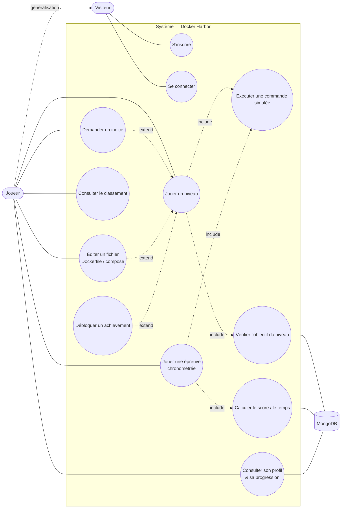

# 1. Diagramme de cas d'utilisation

[← Index](./README.md) · [← Acteurs](./00-acteurs-perimetre.md) · [Activités →](./02-activites.md)

> *Qui utilise le jeu, quelles actions sont possibles, où s'arrêtent les responsabilités du système.*
> Mermaid n'a pas de notation « use case » native : les acteurs sont des nœuds à l'extérieur,
> les cas d'utilisation sont des ellipses `(( ))` dans la frontière du système.

## Lecture des relations

| Relation | Exemple dans le jeu | Pourquoi |
| --- | --- | --- |
| `<<include>>` | « Jouer un niveau » **inclut toujours** « Exécuter une commande » et « Vérifier l'objectif » | comportement **obligatoire** à chaque partie |
| `<<extend>>` | « Demander un indice » **étend** « Jouer un niveau » | comportement **conditionnel** : seulement si le joueur bloque |
| `<<extend>>` | « Débloquer un achievement » étend le jeu | se déclenche **uniquement si** une condition est remplie |
| Généralisation | `Joueur` hérite de `Visiteur` | tout Joueur est aussi un Visiteur |

> Cette vue est **fonctionnelle**, pas technique. Elle ne montre ni MongoDB en détail, ni les
> routes API, ni le simulateur interne — ces éléments arrivent dans les vues suivantes.
