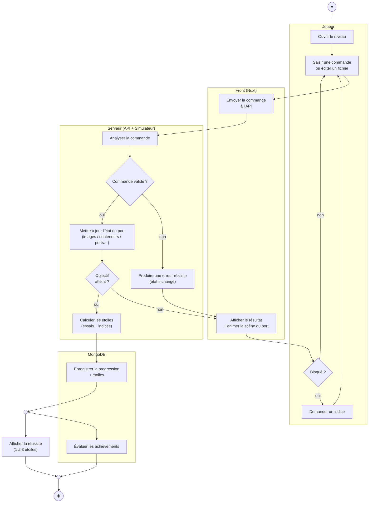

# 2. Diagramme d'activités — « Jouer un niveau »

[← Cas d'utilisation](./01-cas-utilisation.md) · [Index](./README.md) · [Données →](./03-donnees.md)

> *Comment se déroule le processus, quelles décisions, quelles tâches concurrentes,
> et **qui fait quoi** (swimlanes = responsabilités).*

## Mécanismes UML illustrés

- **Decision / Merge** (`{ }`) : « Commande valide ? », « Objectif atteint ? », « Bloqué ? » — un seul chemin est suivi.
- **Fork / Join** (`(( ))`) : après la réussite, l'enregistrement de la progression et l'évaluation des achievements sont **lancés ensemble** (`Promise.all`), puis on **synchronise** (join) avant la fin.
  > ⚠️ **Précision technique** (back TypeScript / Node) : Node est **mono-thread**. Le fork ne représente **pas** du parallélisme CPU mais de la **concurrence asynchrone** : les deux I/O MongoDB sont émises simultanément et leurs temps d'attente se **recouvrent** via la boucle d'événements. C'est ce qu'exprime `await Promise.all([enregistrerProgression(), évaluerAchievements()])`. Du vrai parallélisme CPU exigerait des *Worker Threads*, inutiles ici (on attend des I/O, pas du calcul).
- **Swimlanes** : chaque action est rattachée à son responsable (Joueur / Front / Serveur / MongoDB), ce qui montre bien que **toute la validation et le calcul des étoiles sont côté serveur** (anti-triche).
