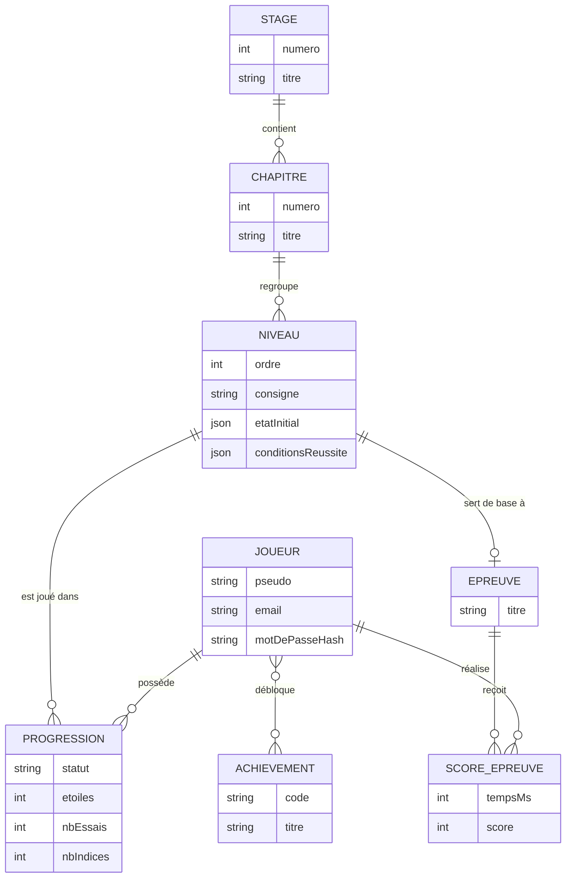
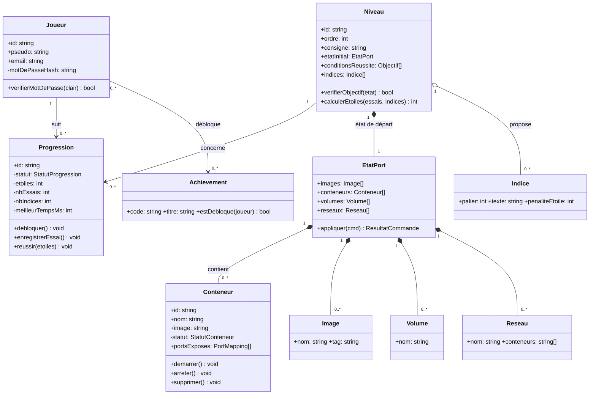

# 3. Modèle de données — du conceptuel aux collections MongoDB

[← Activités](./02-activites.md) · [Index](./README.md) · [Séquence →](./04-sequence.md)

## 3.1 MCD (niveau métier)

Entités métier et cardinalités (notation Merise `0,N` / `1,1`).



**Règles métier (à valider avant implémentation) :**

- Un **Joueur** a 0..N **Progressions** ; chaque Progression appartient à **exactement 1** Joueur et **1** Niveau.
- Un **Stage** contient plusieurs **Chapitres** ; un Chapitre regroupe plusieurs **Niveaux** (débloqués dans l'ordre).
- Un **Joueur** peut débloquer plusieurs **Achievements** (relation N..N → collection de jonction ou tableau de refs).
- Une **Épreuve** s'appuie généralement sur un **Niveau** « cassé à réparer ».

## 3.2 Diagramme de classes UML (niveau application / domaine)

La grande différence avec le MCD : on ajoute les **comportements** (méthodes) et les **invariants**.
La classe `Niveau` sait **valider un objectif** ; `Progression` protège le cycle de vie d'une tentative.



- **Composition** (`*--`) : un `EtatPort` **possède** ses conteneurs/volumes/réseaux — ils n'existent pas hors de l'état de la partie (dépendance de cycle de vie).
- **Agrégation** (`o--`) : un `Niveau` **référence** des indices réutilisables.
- **Association** (`-->`) : `Joueur` ↔ `Progression`, `Niveau` ↔ `Progression`.

## 3.3 MLD → collections MongoDB

Le projet utilise **MongoDB** : pas de clés étrangères SQL, mais des références par `_id` et
quelques documents **embarqués** quand les données sont lues ensemble.

| Collection | Contenu | Références |
| --- | --- | --- |
| `joueurs` | pseudo, email, `motDePasseHash`, dates | — |
| `niveaux` | `chapitreId`, ordre, consigne, `etatInitial`, `conditionsReussite`, `indices[]`, `dialogues[]` | `chapitreId` |
| `chapitres` | `stageId`, numero, titre | `stageId` |
| `progressions` | `joueurId`, `niveauId`, statut, etoiles, nbEssais, nbIndices, meilleurTempsMs | `joueurId`, `niveauId` |
| `epreuves` | `niveauId`, titre, règles de score | `niveauId` |
| `scores` | `joueurId`, `epreuveId`, tempsMs, score, date | `joueurId`, `epreuveId` |
| `achievements` | code, titre, condition | — |
| `joueurs.achievements[]` | tableau embarqué `{ code, dateObtention }` dans `joueurs` | — |

Exemple de document `niveaux` (**le niveau est une donnée, pas du code** — ajouter un niveau
= ajouter un document, sans toucher au simulateur) :

```json
{
  "_id": "n-ch1-02",
  "chapitreId": "ch-1",
  "ordre": 2,
  "titre": "Premier bateau",
  "consigne": "Lance un conteneur nginx nommé 'site'.",
  "etatInitial": { "images": [{ "nom": "nginx", "tag": "latest" }],
                   "conteneurs": [], "volumes": [], "reseaux": [] },
  "conditionsReussite": [
    { "type": "conteneurExiste", "nom": "site", "statut": "RUNNING", "image": "nginx" }
  ],
  "indices": [
    { "palier": 1, "texte": "Il faut 'lancer' une image.", "penaliteEtoile": 0 },
    { "palier": 2, "texte": "Regarde la commande 'docker run'.", "penaliteEtoile": 1 },
    { "palier": 3, "texte": "docker run --name site nginx", "penaliteEtoile": 2 }
  ]
}
```
