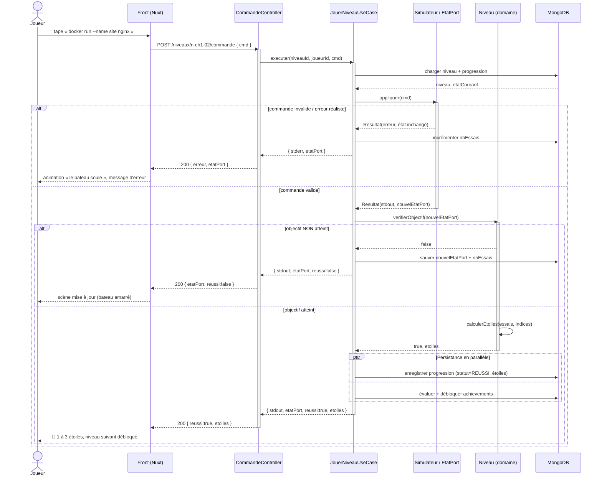

# 4. Diagramme de séquence — « Exécuter une commande dans un niveau »

[← Données](./03-donnees.md) · [Index](./README.md) · [États-transitions →](./05-etats-transitions.md)

> *Qui appelle qui, dans quel ordre, avec quelles réponses.* On distingue les couches
> **Controller → Use Case → Domaine (Niveau/EtatPort) → Repository (MongoDB)**.

## Chemin nominal + erreurs (fragments `alt` / `par`)

## Fragments combinés utilisés

| Fragment | Usage ici |
| --- | --- |
| `alt` | commande invalide vs valide ; objectif atteint vs non |
| `par` | enregistrement de la progression **et** évaluation des achievements en parallèle |

> La **vérification de l'objectif**, le **calcul des étoiles** et l'**état du port** sont produits
> par le serveur. Le front ne fait qu'afficher ce qu'il reçoit → impossible de tricher côté client.

## Participants et couches

| Participant | Responsabilité |
| --- | --- |
| `CommandeController` | Entrée HTTP, (dé)sérialisation, codes de statut |
| `JouerNiveauUseCase` | Orchestration : charger, simuler, valider, persister |
| `Simulateur / EtatPort` | Applique la commande, maintient l'état fictif du port |
| `Niveau` | Règles métier : objectif atteint ? combien d'étoiles ? |
| `MongoDB` | Persistance progression, scores, achievements |
