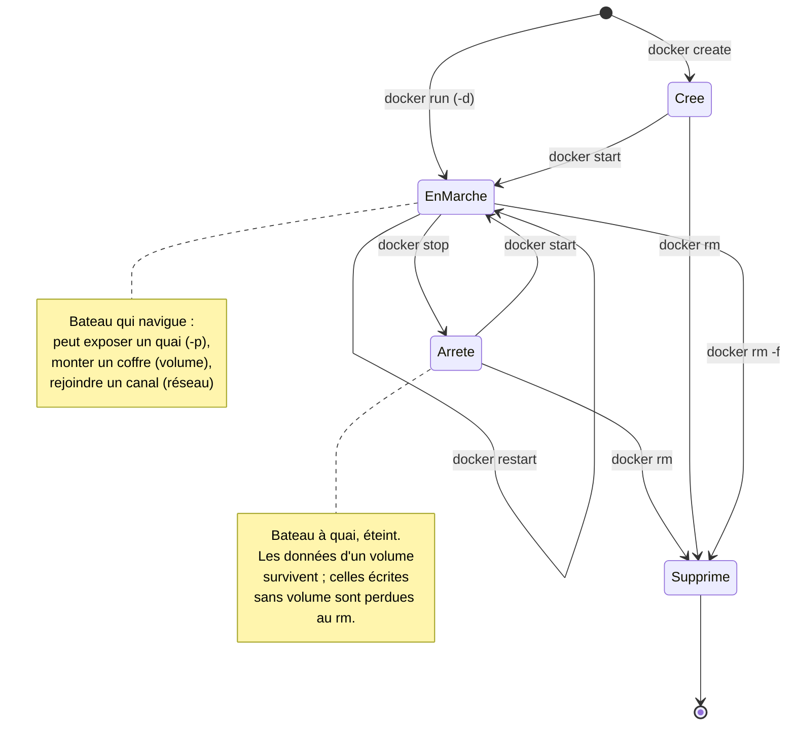
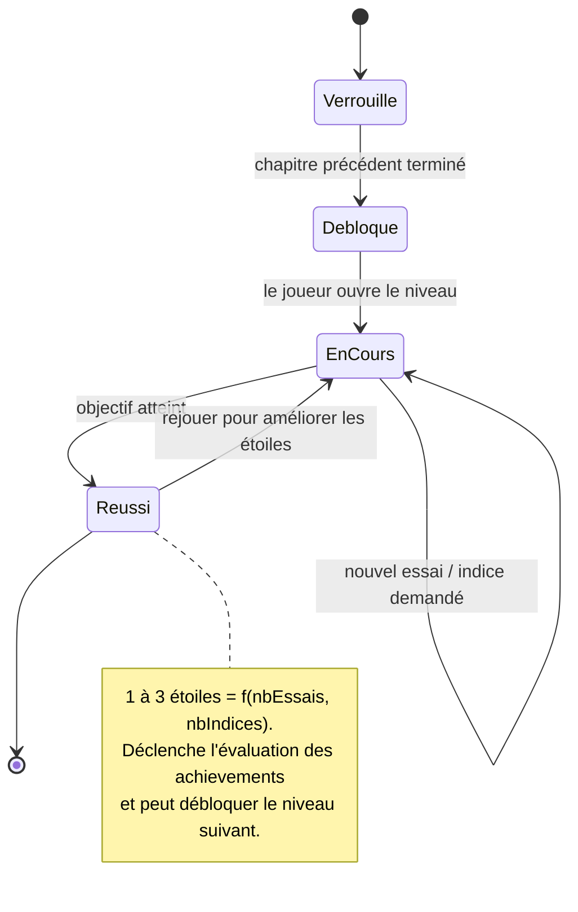

# 5. Diagrammes d'états-transitions

[← Séquence](./04-sequence.md) · [Index](./README.md)

Deux objets ont un **cycle de vie** réglementé : le **Conteneur** (bateau) simulé et la
**Progression** d'un niveau.

## 5.1 Cycle de vie d'un Conteneur (bateau)

Chaque flèche = une transition autorisée, déclenchée par une commande Docker simulée.
Une transition absente = commande refusée (erreur réaliste), exactement comme le vrai Docker.

**Table des transitions** (source de vérité pour les tests du simulateur) :

| État source | Événement (commande) | Garde | État cible |
| --- | --- | --- | --- |
| *(aucun)* | `docker create` | image présente | `Créé` |
| *(aucun)* | `docker run -d` | image présente, nom libre, port libre | `En marche` |
| `Créé` | `docker start` | — | `En marche` |
| `En marche` | `docker stop` | — | `Arrêté` |
| `Arrêté` | `docker start` | port encore libre | `En marche` |
| `Arrêté` / `Créé` | `docker rm` | — | `Supprimé` |
| `En marche` | `docker rm` | **refusé** sans `-f` (erreur) | `En marche` |

## 5.2 Cycle de vie d'une Progression (déblocage + étoiles)

> Comme pour tout objet à cycle de vie : un statut **n'est pas** une simple chaîne modifiable
> librement. Les transitions passent par des méthodes (`debloquer()`, `reussir()`) qui protègent
> les invariants — on ne peut pas « réussir » un niveau encore `Verrouillé`.

## Prochaine étape de conception

Figer :

1. la **table des commandes simulées** supportées (chapitre par chapitre), et
2. la **table des transitions** du conteneur ci-dessus.

Ce sont les deux sources de vérité qui pilotent à la fois le simulateur et ses tests.
