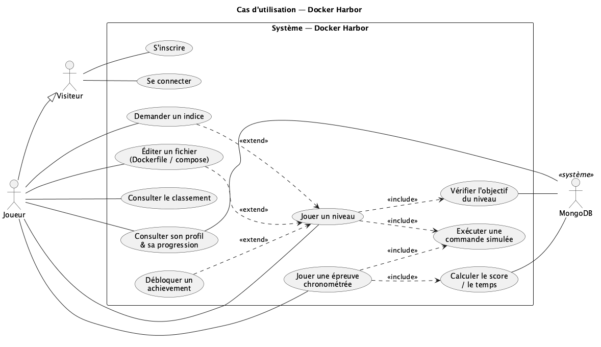
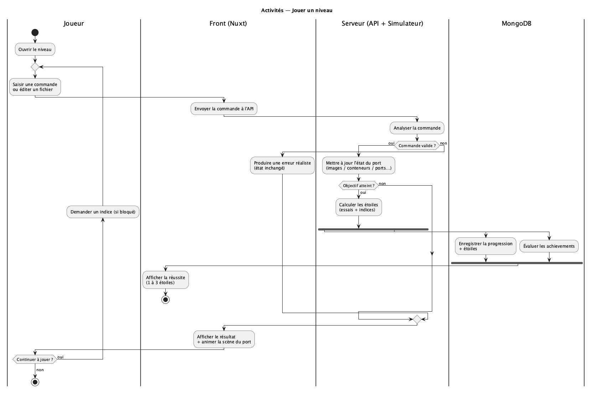
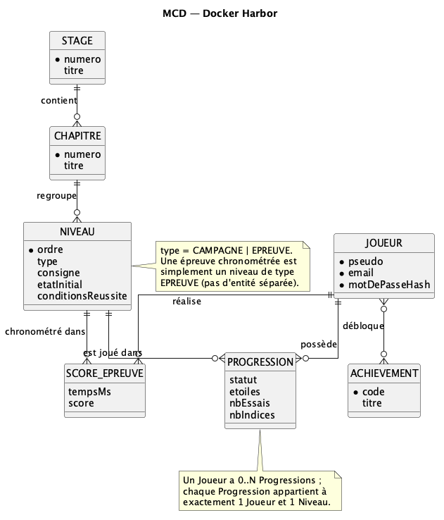
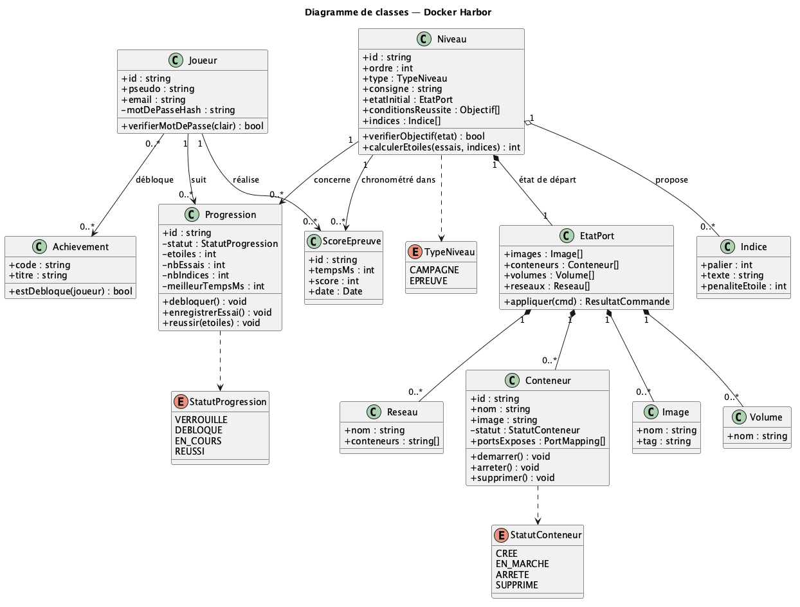
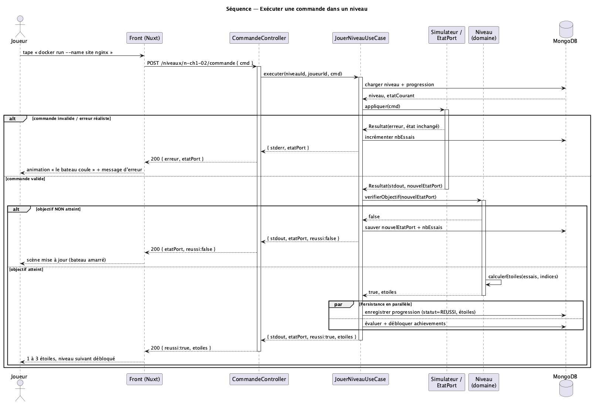
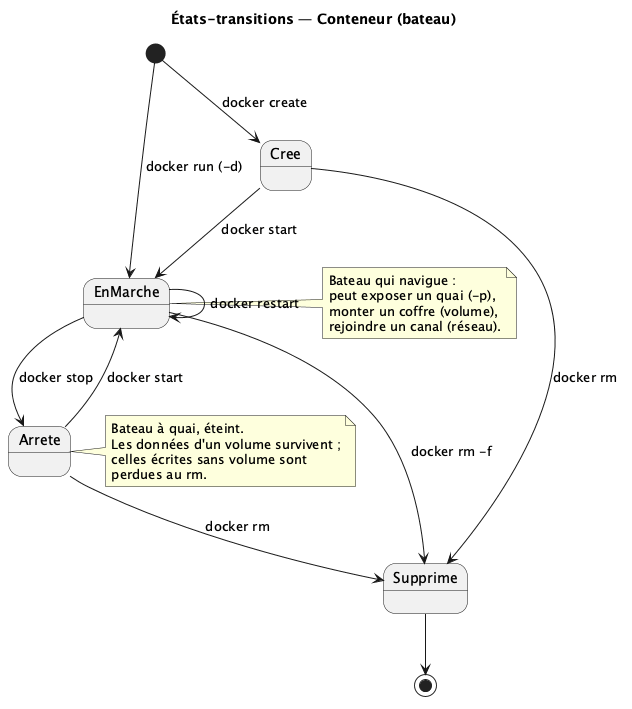
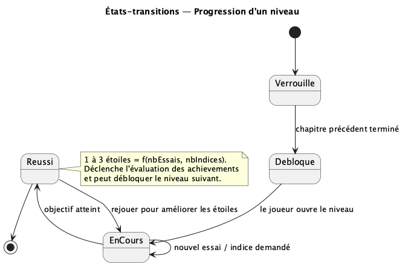

# Modélisation du système — Docker Harbor

Modélisations UML du jeu : jeu web où Docker est entièrement **simulé côté serveur** et
représenté par un **port de commerce** (bateaux = conteneurs, plans = images, quais = ports
exposés, coffres = volumes, canaux = réseaux).

Démarche de conception suivie :

> Cas d'utilisation → Activités → Classes / Données → Séquence → États-transitions

Tous les diagrammes sont en **Mermaid** (rendus directement par GitHub/GitLab).

## Les artefacts

| # | Fichier | Vue | Question à laquelle elle répond |
| --- | --- | --- | --- |
| 0 | [`00-acteurs-perimetre.md`](./00-acteurs-perimetre.md) | Acteurs & périmètre | Qui interagit, où s'arrête le système ? |
| 1 | [`01-cas-utilisation.md`](./01-cas-utilisation.md) | Cas d'utilisation | Que peut-on faire ? |
| 2 | [`02-activites.md`](./02-activites.md) | Activités | Comment se déroule le processus ? |

**Variantes PlantUML (notation UML stricte)** — toutes les vues sont aussi disponibles en
`.puml`, à utiliser si le rendu exige la notation officielle (vrais symboles `usecase`,
`<<include>>`/`<<extend>>`, swimlanes, fork/join, losanges de composition/agrégation) plutôt
que l'approximation Mermaid :

| # | Vue | Source(s) PlantUML |
| --- | --- | --- |
| 1 | Cas d'utilisation | [`01-cas-utilisation.puml`](./01-cas-utilisation.puml) |
| 2 | Activités | [`02-activites.puml`](./02-activites.puml) |
| 3 | Données | [`03-donnees-mcd.puml`](./03-donnees-mcd.puml) · [`03-donnees-classes.puml`](./03-donnees-classes.puml) |
| 4 | Séquence | [`04-sequence.puml`](./04-sequence.puml) |
| 5 | États-transitions | [`05-etats-conteneur.puml`](./05-etats-conteneur.puml) · [`05-etats-progression.puml`](./05-etats-progression.puml) |

> Rendu : `plantuml <fichier>.puml` → PNG/SVG. Sans installation : coller le contenu dans
> <https://www.plantuml.com/plantuml>, ou extension **PlantUML** de VS Code (aperçu `Alt+D`).
> Tous les fichiers ont été validés avec `plantuml -checkonly`.

Les PNG rendus sont versionnés dans [`img/`](./img). Pour les régénérer après modification
d'un `.puml` :

```bash
plantuml -tpng -o img docs/modelisation/*.puml
```

## Aperçus (PNG)

| Vue | Aperçu |
| --- | --- |
| 1 — Cas d'utilisation |  |
| 2 — Activités |  |
| 3 — MCD |  |
| 3 — Classes |  |
| 4 — Séquence |  |
| 5 — États Conteneur |  |
| 5 — États Progression |  |
| 3 | [`03-donnees.md`](./03-donnees.md) | MCD → Classes → MongoDB | Quelle structure de données ? |
| 4 | [`04-sequence.md`](./04-sequence.md) | Séquence | Qui appelle qui, dans quel ordre ? |
| 5 | [`05-etats-transitions.md`](./05-etats-transitions.md) | États-transitions | Quels cycles de vie ? |

## Synthèse : quelle vue répond à quelle question ?

| Vue | Question | Élément central | Pour le jeu |
| --- | --- | --- | --- |
| Cas d'utilisation | Que peut-on faire ? | Acteur / cas | Jouer, indices, épreuves, profil |
| Activités | Comment se déroule le processus ? | Action / décision | Boucle commande → validation → étoiles |
| Classes / Données | Quelle structure ? | Classe / collection | Joueur, Niveau, Progression, EtatPort |
| Séquence | Qui appelle qui ? | Message | Controller → UseCase → Simulateur → Mongo |
| États-transitions | Quels cycles de vie ? | État | Conteneur (bateau), Progression |

## Décisions de modélisation

Choix retenus (simples et efficaces pour MongoDB sur un périmètre de 2 mois) :

1. **Achievements → tableau embarqué** dans `joueurs` (`achievements[]`), le catalogue restant
   dans la collection `achievements`. Peu nombreux, lus avec le profil, écrits rarement : pas de
   collection de jonction ni de jointure.
2. **Une épreuve chronométrée est un Niveau** de `type = EPREUVE` (discriminateur), pas une
   entité séparée. Les `scores` référencent directement `niveauId`. Une entité en moins.
3. **Pas d'acteur Admin.** Les niveaux et épreuves sont des **données** (seeding par les devs),
   hors du périmètre runtime du jeu. Acteurs = `Visiteur`, `Joueur` (+ `MongoDB` en support).

## Notes transverses

- **Aucun vrai Docker n'est exécuté** : le « Simulateur » tient un état fictif et répond comme Docker, erreurs comprises.
- **Validation 100 % serveur** : objectifs, étoiles, scores et état du port sont calculés côté serveur. Le front affiche seulement → anti-triche.
- **Niveaux = données** : un niveau est un document (voir [`03-donnees.md`](./03-donnees.md)) ; en ajouter un ne demande pas de code.
- Mermaid n'a pas de notation « use case » / « activité » natives : elles sont approximées en flowchart. Une version **PlantUML** (notation stricte) peut être fournie si le rendu l'exige.
