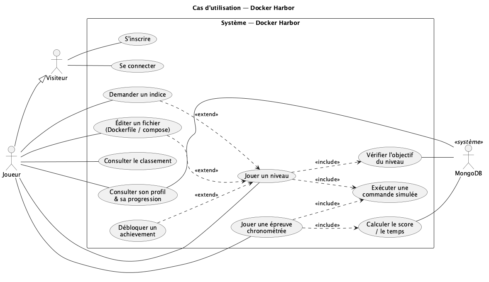
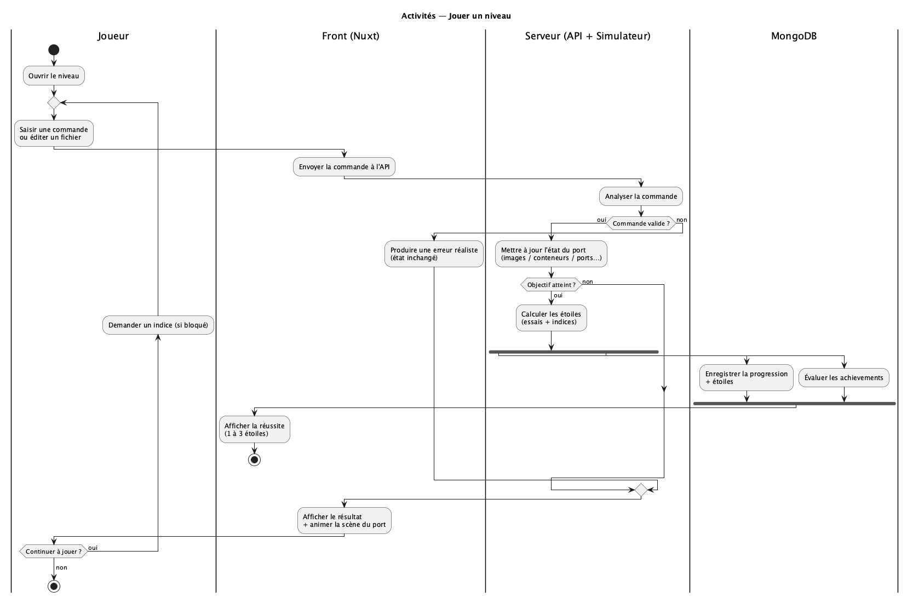
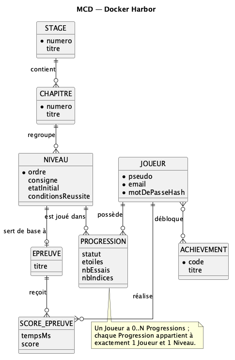
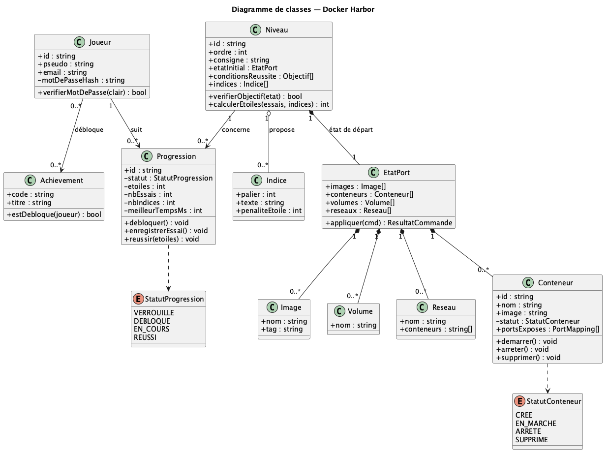
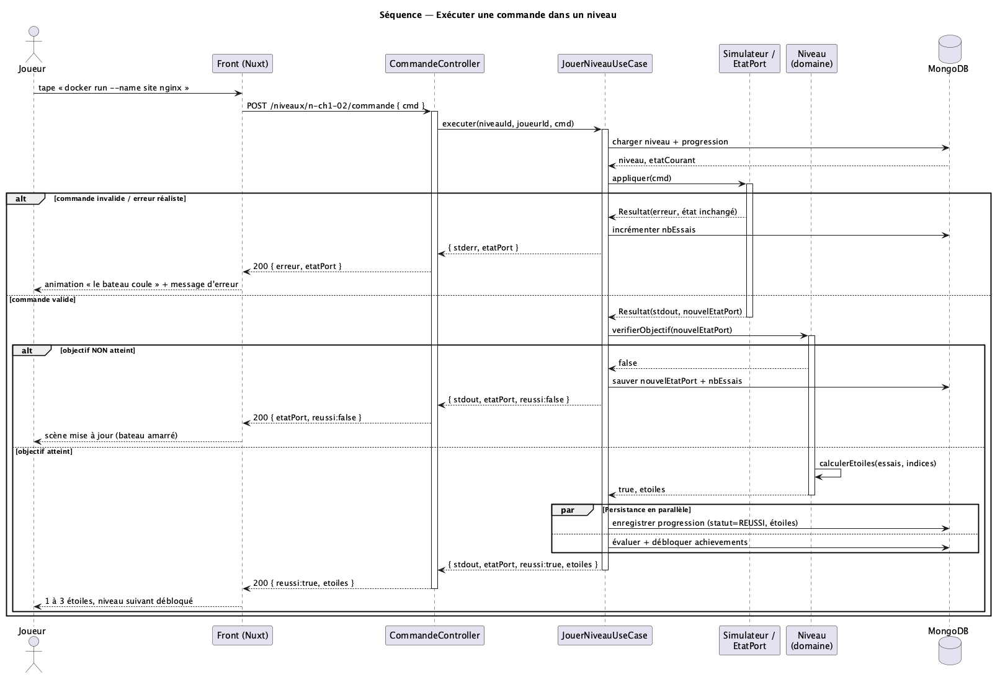
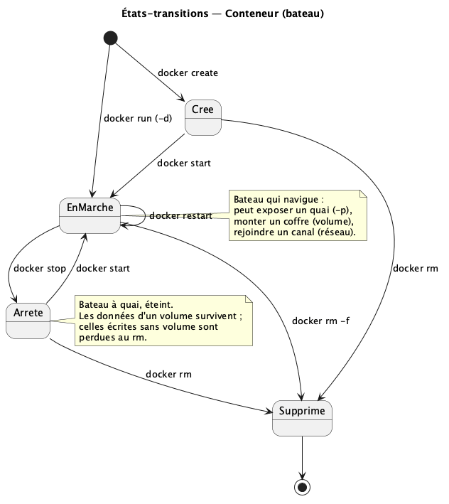
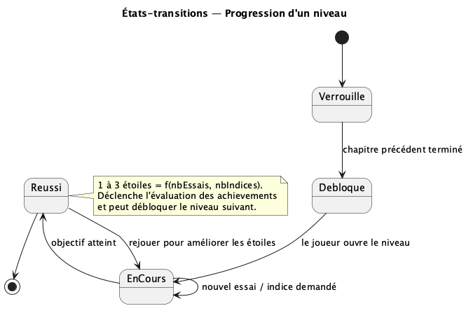

# Docker Harbor — Modélisation du système

**Projet** : jeu web d'apprentissage de Docker, entièrement **simulé côté serveur** et
représenté par un **port de commerce** (bateaux = conteneurs, plans = images, quais = ports
exposés, coffres = volumes, canaux = réseaux).
**Stack** : Nuxt (front) · Express + TypeScript (back) · MongoDB.

Ce document présente les **6 vues de modélisation** du système, dans l'ordre de conception :

> Cas d'utilisation → Activités → Données (MCD + Classes) → Séquence → États-transitions

Chaque vue répond à une question précise :

| Vue | Question |
| --- | --- |
| Cas d'utilisation | Que peut-on faire ? |
| Activités | Comment se déroule le processus ? |
| Données (MCD / Classes) | Quelle structure de données ? |
| Séquence | Qui appelle qui, dans quel ordre ? |
| États-transitions | Quels cycles de vie ? |

---

## 1. Diagramme de cas d'utilisation

Les acteurs (**Visiteur**, **Joueur** qui en hérite) et les services rendus par le système.

- `<<include>>` — comportement **obligatoire** : « Jouer un niveau » inclut toujours « Exécuter une commande » et « Vérifier l'objectif ».
- `<<extend>>` — comportement **conditionnel** : « Demander un indice » ou « Débloquer un achievement » n'arrivent que sous condition.
- **Généralisation** : tout `Joueur` est aussi un `Visiteur`.
- **MongoDB** apparaît en acteur secondaire (persistance).

---

## 2. Diagramme d'activités — « Jouer un niveau »

Le déroulé d'une partie, avec les **responsabilités** (swimlanes) et le **parallélisme**.

- **Swimlanes** : Joueur / Front (Nuxt) / Serveur (API + Simulateur) / MongoDB.
- **Décisions** : « Commande valide ? », « Objectif atteint ? », « Bloqué ? ».
- **Fork / Join** : à la réussite, l'enregistrement de la progression **et** l'évaluation des achievements se font en parallèle.
- Toute la **validation et le calcul des étoiles sont côté serveur** (anti-triche).

---

## 3. Modèle conceptuel de données (MCD)

Les entités métier et leurs cardinalités (notation Merise).

- Un **Joueur** a 0..N **Progressions** ; chaque Progression appartient à 1 Joueur et 1 Niveau.
- Un **Stage** contient des **Chapitres**, qui regroupent des **Niveaux**.
- Une **épreuve chronométrée** n'est pas une entité séparée : c'est un **Niveau** de `type = EPREUVE` ; les **scores** le référencent directement.
- Les **Achievements** débloqués sont rattachés au Joueur (stockés en tableau embarqué côté MongoDB).

---

## 4. Diagramme de classes (domaine)

La structure logicielle : on ajoute les **comportements** (méthodes) et les **invariants**.

- `Niveau.verifierObjectif()` valide l'état ; `Progression` protège son cycle de vie (`debloquer()`, `reussir()`).
- **Composition** (losange plein) : `EtatPort` possède ses conteneurs / images / volumes / réseaux.
- **Agrégation** (losange creux) : `Niveau` référence des `Indice` réutilisables.
- **Enums** : `StatutProgression`, `StatutConteneur`, `TypeNiveau`.

---

## 5. Diagramme de séquence — « Exécuter une commande »

Les échanges entre couches : **Controller → Use Case → Domaine → Repository (MongoDB)**.

- Fragment `alt` : commande invalide (erreur réaliste, état inchangé) vs valide ; objectif atteint vs non.
- Fragment `par` : enregistrement de la progression **et** des achievements en parallèle.
- La vérification de l'objectif, les étoiles et l'état du port sont produits par le **serveur** ; le front affiche seulement.

---

## 6. Diagrammes d'états-transitions

### 6.1 Cycle de vie d'un Conteneur (bateau)

Chaque flèche = une transition autorisée, déclenchée par une commande Docker simulée. Une
transition absente = commande refusée (erreur réaliste), comme le vrai Docker.

### 6.2 Cycle de vie d'une Progression

Du niveau `Verrouillé` au niveau `Réussi` (1 à 3 étoiles). Les transitions passent par des
méthodes qui protègent les invariants — on ne peut pas « réussir » un niveau encore verrouillé.

---

## Synthèse

| Vue | Élément central | Pour le jeu |
| --- | --- | --- |
| Cas d'utilisation | Acteur / cas | Jouer, indices, épreuves, profil |
| Activités | Action / décision | Boucle commande → validation → étoiles |
| Données | Classe / collection | Joueur, Niveau, Progression, EtatPort |
| Séquence | Message | Controller → UseCase → Simulateur → Mongo |
| États-transitions | État | Conteneur (bateau), Progression |

*Sources éditables des diagrammes (Mermaid et PlantUML) : dossier
[`docs/modelisation/`](./README.md).*
